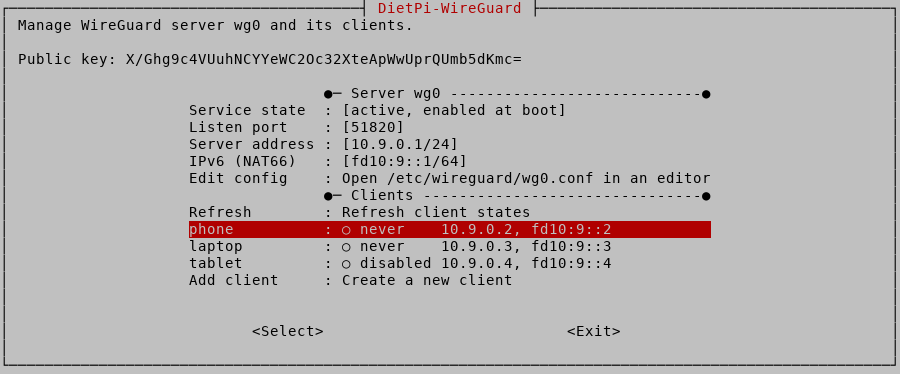

# Release Notes

## October 2026 (version 10.8)

### Overview

The **October 10th, 2026** release of **DietPi v10.8** comes with a new tool to manage WireGuard servers and clients, support for Quartz64 optical drives, named `dietpi-software` IDs, our own HAProxy APT package, and further enhancements and fixes.

{: width="900" height="374" loading="lazy"}

### New tools

- [**DietPi-Tools**](../dietpi_tools.md) | [**DietPi-WireGuard**](../dietpi_tools/software_installation.md#dietpi-wireguard) :octicons-arrow-right-16: This new tool manages WireGuard servers and their clients via menu or command line: create servers and clients, show client configs as QR code, disable, enable and remove clients, change their settings, and the server port, address and IPv6. It works with existing configs in `/etc/wireguard`, hence also for servers which were not installed via `dietpi-software`. The latter creates its server config via `dietpi-wireguard init` now, and no client anymore. New servers get an IPv6 subnet (NAT66) and IPv6 forwarding, so that clients can use IPv6 through the VPN, which did not work with the previous config. Existing servers can turn IPv6 on via `dietpi-wireguard`. Disabling IPv6 via `dietpi-config` turns it off for WireGuard servers, as they could not start otherwise. Many thanks to @Vansinnet for requesting this feature: <https://github.com/MichaIng/DietPi/issues/3100>

### Enhancements

- [**Quartz64**](../hardware.md#pine64) :octicons-arrow-right-16: Support for ATAPI/SCSI CD/DVD/Blu-ray drives, and the ISO format with common extensions, have been added to our kernel builds. Many thanks to @NoProblemsHere for suggesting this: <https://dietpi.com/forum/t/25511>
- [**DietPi-Tools**](../dietpi_tools.md) | [**DietPi-Config**](../dietpi_tools/system_configuration.md#dietpi-config) :octicons-arrow-right-16: The option to change the system hostname has been moved from "Security Options" to the better fitting "Network Options: Misc" submenu. Many thanks to @ikem-krueger for this suggestion: <https://github.com/MichaIng/DietPi/issues/7218>
- [**DietPi-Tools**](../dietpi_tools.md) | [**DietPi-Config**](../dietpi_tools/system_configuration.md#dietpi-config) :octicons-arrow-right-16: Added a "Time sync timeout" setting next to "Time sync mode", stored as `CONFIG_TIMESYNC_TIMEOUT` in `dietpi.txt` (default: 60 seconds). Many thanks to everyone who reported and discussed this: <https://github.com/MichaIng/DietPi/issues/6684>
- [**DietPi-Software**](../dietpi_tools/software_installation.md#dietpi-software) :octicons-arrow-right-16: Software IDs are now named instead of numeric, e.g. `nodered` instead of 122, derived from the software name in lower case with all dashes, dots, underscores, spaces and other special characters removed. This applies to the CLI, the search menu, `AUTO_SETUP_INSTALL_SOFTWARE_ID` in `dietpi.txt`, `/boot/dietpi/.installed`, and the DietPi-Survey upload. Input is normalised the same way, so `Node-RED` is accepted. Numeric IDs are still accepted everywhere, and existing `/boot/dietpi/.installed` files are migrated. The `dietpi-software free` command has been removed, as IDs are unique by name.
- [**DietPi-Software**](../dietpi_tools/software_installation.md#dietpi-software) | [**HAProxy**](../software/advanced_networking.md#haproxy) :octicons-arrow-right-16: We provide our own HAProxy DEB package via our APT server now. A source build on (re)install, and related build dependencies, are hence not required anymore, and updates are applied via `apt upgrade`. We additionally hardened our default config, letting workers run as dedicated `haproxy` system user, and applying some sandboxing to the systemd service. Existing `/etc/haproxy/haproxy.cfg` is not touched, and we generally aim to keep our package widely compatible with Debian's package. Users who did previously install HAProxy via `apt` from Debian instead of `dietpi-software`, will receive this package upgrade as well. Please let us know if you face any issues or incompatibilities with this. Our additional sandboxing should not cause any breakage, but possible that we missed something. And our package ships the latest release, while Debian is some subversions behind, even in testing and unstable, at time of writing. Many thanks to @gitzjoey for reporting that our default config did let workers run unnecessarily as root: <https://dietpi.com/forum/t/25490>

### Bug fixes

- **UTM VMs** :octicons-arrow-right-16: Our appliance configuration has been updated for ARM and UEFI support. Previously, a wrong architecture string was used for ARM, UEFI boot was always disabled, and outdated virtual hardware was used. The new config uses VirtIO hardware where available. Very old UTM versions might not be able to import these new appliances. Let us know if this is the case for you, and updating UTM is not possible for some reason. Many thanks to @oxoocoffee for reporting this issue, and testing new appliances on Apple Silicon hosts: <https://github.com/MichaIng/DietPi/issues/8317>
- [**DietPi-Tools**](../dietpi_tools.md) | [**DietPi-Drive_Manager**](../dietpi_tools/system_configuration.md#dietpi-drive-manager) :octicons-arrow-right-16: Resolved an issue where formatting a drive with HFS+ failed on Debian Trixie and later, as the legacy HFS non-plus `hfsutils` package was attempted to be installed, which is not available anymore since Debian Trixie. Many thanks to @k8seren for reporting this issue: <https://github.com/MichaIng/DietPi/issues/8328>
- [**DietPi-Tools**](../dietpi_tools.md) | [**DietPi-Drive_Manager**](../dietpi_tools/system_configuration.md#dietpi-drive-manager) :octicons-arrow-right-16: Resolved an issue where NFS exports with spaces in their share path were shown truncated in the export list, and could not be permanently mounted when entering the path manually. Spaces in exported shares are now correctly handled and shown in the exports list, and encoded as `\040` in `/etc/fstab` entries, like it was done for Samba/CIFS shares already. Many thanks to @thr-4 for reporting this issue: <https://github.com/MichaIng/DietPi/issues/8332>
- [**DietPi-Tools**](../dietpi_tools.md) | [**DietPi-Network**](../dietpi_tools/system_configuration.md#dietpi-network) :octicons-arrow-right-16: Resolved an issue where changes to WiFi hotspot settings (SSID, key, frequency, channel, and WiFi standards) were instantly reverted in the interface menu, since they were reloaded from the config files whenever the menu was redrawn. Changes are now kept until saved or applied. Many thanks to @Zoatebix for reporting this issue: <https://github.com/MichaIng/DietPi/issues/8335>
- [**DietPi-Tools**](../dietpi_tools.md) | [**DietPi-Network**](../dietpi_tools/system_configuration.md#dietpi-network) :octicons-arrow-right-16: Resolved an issue where configuring a network interface as hotspot still caused `wpa_supplicant` to start, which broke the hotspot if it succeeded to connect to a network, i.e. if `/etc/wpa_supplicant/wpa_supplicant.conf` contained credentials for an SSID in range already. Many thanks to @CVBruce for reporting this issue: <https://dietpi.com/forum/t/25514>
- [**DietPi-Software**](../dietpi_tools/software_installation.md#dietpi-software) | [**UrBackup**](../software/cloud.md#urbackup) :octicons-arrow-right-16: Resolved an issue where the uninstall failed with "Read-only file system" errors when the backup location contained Btrfs snapshots created by UrBackup, which are read-only subvolumes. If such snapshots are found, you are now asked whether to delete them together with the backups. When skipping, the uninstall continues but the backup location is left untouched. Many thanks to @anika200 for reporting this issue: <https://dietpi.com/forum/t/25501>
- [**DietPi-Software**](../dietpi_tools/software_installation.md#dietpi-software) | [**Immich Machine Learning**](../software/cloud.md#immich-machine-learning) :octicons-arrow-right-16: Resolved an issue where the service failed to start due to a missing new submodule. Due to changed Python version requirements, support for Debian Bookworm and Forky needed to be removed. If you run Immich-ML on Bookworm, consider upgrading to Debian Trixie, following our guide: <https://dietpi.com/blog/?p=4014>. In a future release, we may restore support for all Debian versions by switching to a `uv`-managed Python instance, but that has not been decided yet. Many thanks to @nighthawk2111 for reporting this issue: <https://github.com/MichaIng/DietPi/issues/8356>

As always, many smaller code performance and stability improvements, visual and spelling fixes have been done, too many to list all of them here. Check out all code changes of this release on GitHub: <https://github.com/MichaIng/DietPi/pull/8354>
