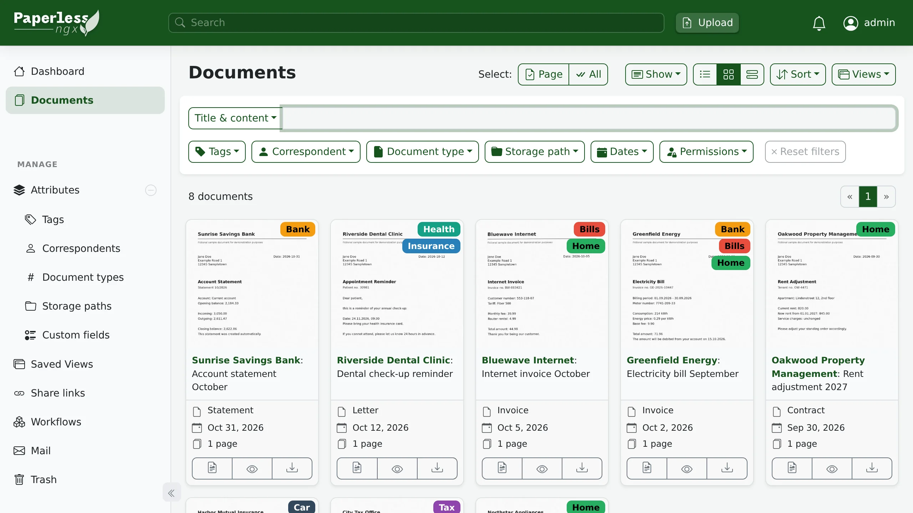

# Release Notes

## November 2026 (version 10.9)

### Overview

The **November 21st, 2026** release of **DietPi v10.9** comes with new images for Odroid C5, Orange Pi 6/6 Plus, Orange Pi Zero 4 and Orange Pi 4A, the new software options Paperless-ngx, Yuvomi, SolidPing and Podman, and a new `dietpi-fan_control` tool to configure temperature-controlled cooling fans on Raspberry Pi. Additionally, `dietpi-network` received a more robust WiFi auto-reconnect and gateway subnet checks, `dietpi-software` IDs can be completed with the tab key, and Readarr and Mono have been removed from our software catalogue. As always, further enhancements and bug fixes are included.

{: width="1280" height="720" loading="lazy"}

### New images

- [**Odroid C5**](../hardware.md#odroid) :octicons-arrow-right-16: Support and images for this new Hardkernel SBC with Amlogic S905X5M SoC have been added.
- [**Orange Pi 6/6 Plus**](../hardware.md#orange-pi-series) :octicons-arrow-right-16: Support and images for these new Orange Pi 6 family SBCs with CIX P1 dodeca-core (12) SoC have been added. The image uses a generic ACPI kernel, and bootloader + device tree come from the onboard UEFI firmware. Hence it should work on any CIX P1 board with UEFI and ACPI-capable firmware.
- [**Orange Pi Zero 4**](../hardware.md#orange-pi-series) :octicons-arrow-right-16: Support and images for this new SBC with Allwinner A733 SoC have been added. It is very similar to the Orange Pi Zero 3W, but adds Gigabit Ethernet. Like for the Zero 3W, Xunlong's Linux 6.6 and U-Boot vendor sources are used.
- [**Orange Pi 4A**](../hardware.md#orange-pi-series) :octicons-arrow-right-16: Images for this SBC with Allwinner T527 SoC have been added. Note that it uses a mainline Linux based kernel, which lacks support for CPU scheduling, hence all cores run at a fixed 768 MHz. A patch is in review: <https://lwn.net/Articles/1096895/>

### New software

- [**dietpi-software**](../dietpi_tools/software_installation.md#dietpi-software) | [**Paperless-ngx**](../software/cloud.md#paperless-ngx) :octicons-arrow-right-16: This document management system turns your scanned paper documents into a searchable online archive, with OCR, automatic tagging and full-text search. It has been added to our software catalogue with ID `paperlessngx`. It is available for ARMv8 and x86_64 systems with at least 2 GiB total memory (RAM + swap). Many thanks to everyone who requested this: <https://github.com/MichaIng/DietPi/discussions/5489>
- [**dietpi-software**](../dietpi_tools/software_installation.md#dietpi-software) | [**Yuvomi**](../software/cloud.md#yuvomi) :octicons-arrow-right-16: This self-hosted family planner with calendar, tasks, meal planning, shopping lists and budget has been added to our software catalogue. Many thanks to @miloit for implementing this software option: <https://github.com/MichaIng/DietPi/pull/8461>
- [**dietpi-software**](../dietpi_tools/software_installation.md#dietpi-software) | [**SolidPing**](../software/system_stats.md#solidping) :octicons-arrow-right-16: This self-hosted uptime monitoring tool with status pages and alerting has been added to our software catalogue with ID `solidping`. Many thanks to @fclairamb for implementing this software option: <https://github.com/MichaIng/DietPi/pull/8366>
- [**dietpi-software**](../dietpi_tools/software_installation.md#dietpi-software) | [**Podman**](../software/system_stats.md#podman) :octicons-arrow-right-16: This daemonless container engine with Docker-compatible CLI and API has been added to our software catalogue with ID `podman`. Like Docker, containers and images are stored in `/mnt/dietpi_userdata/podman-data`, and logs go to the systemd journal. Containers are meant to be run as individual systemd units, e.g. via Quadlet: <https://github.com/MichaIng/DietPi/pull/8480>

### Removed software

- [**dietpi-software**](../dietpi_tools/software_installation.md#dietpi-software) | **Readarr** :octicons-arrow-right-16: It has been archived by its maintainers last year. Use e.g. [LazyLibrarian](../software/bittorrent.md#lazylibrarian) instead. The DietPi update won't remove Readarr from your system, so you can keep using it if installed already. Once you found a replacement, see here how to cleanly remove Readarr: <https://github.com/MichaIng/DietPi/pull/8388>
- [**dietpi-software**](../dietpi_tools/software_installation.md#dietpi-software) | **Mono** :octicons-arrow-right-16: This .NET runtime has been superseded by modern .NET since years. It was only needed on our end to support running several Servarr applications on ARMv6 Raspberry Pi models, since .NET does not support that architecture. However, those Servarr applications dropped support for Mono years ago, too, hence we needed to install outdated versions on those RPi models, which, at least from a security perspective, is irresponsible. [Sonarr](../software/bittorrent.md#sonarr), [Radarr](../software/bittorrent.md#radarr), [Lidarr](../software/bittorrent.md#lidarr), and [Jackett](../software/bittorrent.md#jackett) have hence been disabled for ARMv6, along with the Mono removal. The DietPi update won't remove software from your DietPi system. We strongly recommend to find an alternative setup. Find instructions about a clean removal of Mono, and in case those Servarr applications on ARMv6, here: <https://github.com/MichaIng/DietPi/pull/8388>

### New tools

- [**DietPi tools**](../dietpi_tools.md) | [**dietpi-fan_control**](../dietpi_tools/system_configuration.md#dietpi-fan-control) :octicons-arrow-right-16: This new script allows to configure temperature-controlled cooling fans on [Raspberry Pi](../hardware.md#raspberry-pi). It can be started via `dietpi-fan_control` command, or from [`dietpi-config`](../dietpi_tools/system_configuration.md#dietpi-config) > "Performance Options" > "Fan Control". Fans attached to the GPIO header can be driven via hardware PWM (`pwm-fan` overlay, Debian Trixie and later, not on RPi 5), software PWM (`pwm-gpio-fan` overlay), or simple on/off switching (`gpio-fan` overlay). On RPi 5, the trip points of the dedicated PWM fan port can be configured as well. For each trip point, temperature, hysteresis and fan speed can be adjusted. Settings are stored in `/boot/firmware/config-fan.txt`, which is included by `config.txt`, so that fan control can be disabled without losing the trip point settings. Many thanks to @zumbiepig for implementing the new `pwm-fan` overlay into the official RPi kernel, and starting the implementation of this feature for DietPi: <https://github.com/MichaIng/DietPi/pull/8269>

### Enhancements

- [**Quartz64**](../hardware.md#pine64) :octicons-arrow-right-16: A Linux headers package has been added, which allows to compile kernel modules. Install it via `apt install linux-headers-quartz64`, which works on Model A, B, and SOQuartz the same way. Many thanks to @yoshibox for this suggestion: <https://github.com/MichaIng/DietPi/issues/8470>
- [**Odroid C2**](../hardware.md#odroid) :octicons-arrow-right-16: Overlays to enable the HiFi Shield 2/Plus have been added to our kernel builds. The `dietpi-config` audio option entries make use of them, hence have been fixed for mainline Linux.
- **bash** :octicons-arrow-right-16: When completing a word with the ++tab++ key while the cursor is inside it, the characters after the cursor are no longer duplicated if they match the completion. E.g. if `foobarbaz` is a completion option, `foo<cursor>bar<tab>` now gives `foobarbaz` instead of `foobarbazbar`. This change comes along with a bash-completion extension for `dietpi-software` (see below).
- [**DietPi tools**](../dietpi_tools.md) | [**dietpi-banner**](../dietpi_tools/system_configuration.md#dietpi-banner) :octicons-arrow-right-16: On Raspberry Pi systems, a warning is now shown if the firmware detected undervoltage or high temperature and in case lowered the CPU frequency and/or voltage in turn. Many thanks to @Marzal for implementing this: <https://github.com/MichaIng/DietPi/pull/8203>
- [**DietPi tools**](../dietpi_tools.md) | [**dietpi-banner**](../dietpi_tools/system_configuration.md#dietpi-banner) :octicons-arrow-right-16: The pre-login banner with DietPi version, time, date and LAN IP address is now shown by the login prompt itself, on every local, serial and container console, instead of being printed once at the end of the boot process to the main console only. It is stored at `/etc/issue.d/dietpi-banner.issue`, and can be regenerated with the new `dietpi-banner issue` command. Time, date and IP address are hence up-to-date whenever the login prompt is printed, and the banner cannot interfere with a login in progress anymore. The default login credentials are shown there until the first run setup has finished.
- [**DietPi tools**](../dietpi_tools.md) | [**dietpi-cloudshell**](../software/system_stats.md#dietpi-cloudshell) :octicons-arrow-right-16: Support for Pi-hole v6 was finally added.
- [**DietPi tools**](../dietpi_tools.md) | [**dietpi-vpn**](../dietpi_tools/software_installation.md#dietpi-vpn) :octicons-arrow-right-16: The ProtonVPN server selection menu now shows the server name and city, in addition to the domain name. From the domain name, the entry and exit country can be derived. The server name gives the same info, and free plan servers are additionally prefixed with "FREE".
- [**DietPi tools**](../dietpi_tools.md) | [**dietpi-network**](../dietpi_tools/system_configuration.md#dietpi-network) :octicons-arrow-right-16: The WiFi monitor for the auto-reconnect feature does now continue to send pings every second within the 10 seconds default `ping` deadline, until receiving a reply, be it a response from the gateway, or an ARP error. This prevents unnecessary interface restarts in case of flaky connections, where a single ping might get lost. An interface restart includes fresh WPA authentication, DHCP etc., hence may take a few seconds, during which connectivity is down. This should be avoided if the AP is generally still in range. Additionally, the interval between connection checks can be configured with the new "Auto Reconnect" submenu in `dietpi-network` WiFi interface settings. Many thanks to @cbrenberg for reporting related issues, and providing a solution approach: <https://github.com/MichaIng/DietPi/issues/6907>
- [**DietPi tools**](../dietpi_tools.md) | [**dietpi-network**](../dietpi_tools/system_configuration.md#dietpi-network) :octicons-arrow-right-16: A warning is now shown when a static gateway is about to be applied which is outside of the subnet of the static IP address, a common misconfiguration which breaks Internet access. It offers to use the first host address of the subnet as gateway instead. Additionally, when changing the static IP address in the menu, the gateway is adjusted automatically, if it does not match the new subnet. Many thanks to @ralph303 for this suggestion: <https://github.com/MichaIng/DietPi/issues/7542>
- [**DietPi tools**](../dietpi_tools.md) | **dietpi-globals** :octicons-arrow-right-16: Our `apt update` wrapper `G_AGUP` does now catch errors caused by the system clock being behind, if the network time sync failed or did not happen yet at boot. It automatically triggers one time sync attempt in case of a matching error message, and the error handler shows a "Sync clock" entry. Many thanks to @zumbiepig for suggesting this enhancement: <https://github.com/MichaIng/DietPi/issues/8283>
- [**DietPi tools**](../dietpi_tools.md) | [**dietpi-software**](../dietpi_tools/software_installation.md#dietpi-software) :octicons-arrow-right-16: Commands and software IDs can now be completed with the ++tab++ key in interactive bash shells, e.g. `dietpi-software install node<tab>`. The `install` command offers software titles which are not installed and available on the system, while `reinstall` and `uninstall` offer the installed ones.
- [**dietpi-software**](../dietpi_tools/software_installation.md#dietpi-software) | [**Node.js**](../software/programming.md#nodejs) :octicons-arrow-right-16: Our installer pulls the latest LTS version now, instead of the highest stable version. This enhances compatibility with certain software and its plugins/extensions/apps, and enhances security in case of ARMv7 and RISC-V: Builds for those in latest non-LTS stopped, while their latest LTS versions still get regular updates. Many thanks to @TadyTheFish for reporting issues with some Node-RED plugin, and @lallafa for reporting stopped non-LTS updates for ARMv6: <https://github.com/MichaIng/DietPi/issues/7324>
- [**dietpi-software**](../dietpi_tools/software_installation.md#dietpi-software) | [**Node-RED**](../software/hardware_projects.md#node-red) :octicons-arrow-right-16: The latest version is now installed on ARMv6 RPi models, too. The `@node-rs/bcrypt` dependency which does not support the architecture is an optional one, and now skipped on ARMv6.

### Bug fixes

- [**UTM VMs**](../hardware.md#utm) :octicons-arrow-right-16: Further fixes to our UTM VM appliances have been applied. This time, they really import well on Apple Silicon and Intel hosts. Many thanks to @oxoocoffee and @Ctrl-Alb for the testing efforts: <https://github.com/MichaIng/DietPi/issues/8317>
- [**DietPi tools**](../dietpi_tools.md) | [**dietpi-banner**](../dietpi_tools/system_configuration.md#dietpi-banner) :octicons-arrow-right-16: Resolved an issue where the disk usage info could hang the banner, and hence the SSH login, if any mounted network share (NFS/SMB) was offline, even if it was not selected to be shown. On Debian Trixie and later, only the mounts matching the configured mounts and patterns are queried now. For reliable drive pattern matching, those are now stored and expected in raw format, rather than in the `\xHH` escaped form returned by `findmnt -r`. For non-pattern mount paths, the migration is done automatically on DietPi update. If drive patterns were entered with literal `\xHH` escape codes, those need to be adjusted after the DietPi update. Many thanks to @miloit for solving this issue: <https://github.com/MichaIng/DietPi/pull/8374>
- [**DietPi tools**](../dietpi_tools.md) | [**dietpi-vpn**](../dietpi_tools/software_installation.md#dietpi-vpn) :octicons-arrow-right-16: The ProtonVPN server selection menu has been fixed. The server list cannot be fetched from the API without authentication anymore, but a 3rd party repository provides a regularly updated list, fetched from the same API.
- [**DietPi tools**](../dietpi_tools.md) | [**dietpi-network**](../dietpi_tools/system_configuration.md#dietpi-network) :octicons-arrow-right-16: Resolved an issue where saving interface settings, without applying them, while resolving a network conflict by disabling the conflicting interface, brought down the conflicting interface immediately, while the saved interface was not brought up. This left the system without network access, and broke the SSH connection if one was used. If settings are only saved, the conflicting interface is now only saved as disabled as well, to be applied on next reboot. Additionally, if settings are applied, the conflict dialog offers to disable the conflicting interface and save all changes for next reboot, instead of applying them right away, which is safer when connected via SSH.
- [**DietPi tools**](../dietpi_tools.md) | [**dietpi-wireguard**](../dietpi_tools/software_installation.md#dietpi-wireguard) :octicons-arrow-right-16: Resolved an issue where VPN clients had no access to the local network and Internet through the server, if [Docker](../software/system_stats.md#docker) is installed, as it sets the default policy for forwarded traffic to DROP. Replies to VPN clients are now accepted explicitly. On DietPi update, the needed rules are added to the server config `/etc/wireguard/wg0.conf`, if [WireGuard](../software/vpn.md#wireguard) was installed via `dietpi-software`, and if the config does not handle forwarding rules otherwise already. Many thanks to @Ctrl-Alb for reporting this issue: <https://github.com/MichaIng/DietPi/issues/8500>
- [**DietPi tools**](../dietpi_tools.md) | [**dietpi-software**](../dietpi_tools/software_installation.md#dietpi-software) :octicons-arrow-right-16: Resolved an issue where files extracted from upstream archives kept the user and group of the upstream build system, instead of being owned by root. This affected the binaries of [uv](../software/programming.md#uv), [frp](../software/advanced_networking.md#frp), [Kubo](../software/distributed_projects.md#ipfs-node), [Spotifyd](../software/media.md#spotifyd) and [BirdNET-Go](../software/camera.md#birdnet-go), and the Easy-RSA scripts of [OpenVPN](../software/vpn.md#openvpn). The ownership of affected files is reset during the DietPi update: <https://github.com/MichaIng/DietPi/pull/8382>

As always, many smaller code performance and stability improvements, visual and spelling fixes have been done, too many to list all of them here. Check out all code changes of this release on GitHub: <https://github.com/MichaIng/DietPi/pull/8504>
